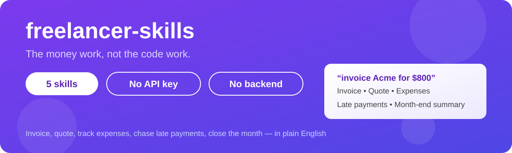

<p align="center">
  
</p>

<p align="center">
  <b>🚀 Try the live demo — <a href="https://smabdulmueid97.github.io/freelancer-skills/demo/">See it in action</a></b>
</p>

<p align="center">
  <a href="https://github.com/smabdulmueid97/freelancer-skills/blob/main/LICENSE"></a>
  <a href="https://github.com/smabdulmueid97/freelancer-skills"></a>
  <a href="https://smabdulmueid97.github.io/freelancer-skills/demo/"></a>
  <a href="https://github.com/smabdulmueid97/freelancer-skills/stargazers"></a>
</p>

<h1 align="center">freelancer-skills</h1>

<p align="center">
  Claude Code skills for solo freelancers — <b>the money work, not the code work</b>.<br />
  Invoice, quote, track expenses, chase late payments, and close the month — from a plain-English prompt, with <b>no API key, no backend, no signup</b>.
</p>

<p align="center">
  <a href="#-skills-included">Skills</a> •
  <a href="#-install-30-seconds">Install</a> •
  <a href="#-no-claude-demo">Demo</a> •
  <a href="#-related-repos">Related repos</a> •
  <a href="#-layout">Layout</a>
</p>

---

## Why this exists

Every trending skill pack is for developers, traders, or SEO. None covers the daily money workflow of a freelancer — invoicing, quotes, expenses, late-payment follow-ups. That's this repo.


## 📋 Skills included

| Skill | Trigger | What it does |
|---|---|---|
| `invoice` | "invoice Acme for $800 for the website" | Builds a professional invoice (numbered, dated, due date, tax/VAT, multi-currency), as Markdown + printable HTML/PDF |
| `quote` | "quote $1,200 for a logo + 2 revisions" | Builds a fixed-price quote / estimate with scope, exclusions, validity (14 days), payment terms |
| `expense-tracker` | "log $45 for Figma, client Acme" | Logs an expense, categorises it, keeps a running monthly total per client / category |
| `payment-followup` | "chase the unpaid invoice #104" | Writes a polite 1st / 2nd / final reminder — firm, not rude — with the exact amount, due date and payment link |
| `monthly-summary` | "close October" | Totals invoiced, paid, outstanding, expenses and profit for the month, per client, with the top 3 overdue invoices |

Each skill is one `SKILL.md` — read it, copy the folder, done. No dependencies.

## 🚀 Install (30 seconds)

```bash
git clone https://github.com/smabdulmueid97/freelancer-skills.git
./scripts/install.sh
# copies skills/ → ~/.claude/skills/
```

Or manually: copy any `skills/<name>/` folder into `~/.claude/skills/<name>/`.

Then in Claude Code, just talk normally:

```
invoice Bright Studio for $650 — homepage redesign, 50% upfront, due in 14 days
quote $900 for a landing page, 2 revisions, valid 14 days
log $29 for hosting, client Bright Studio
chase invoice #INV-1042, it's 12 days overdue
close October
```

## 🧪 No-Claude demo

Try it in 10 seconds, no Claude needed: **[live demo](https://smabdulmueid97.github.io/freelancer-skills/demo/)** — or open `demo/index.html` locally. Type a client + amount, print to PDF.

The demo is a single-file invoice generator (the same logic as the `invoice` skill, in the browser):

- Add line items, tax / VAT, discount, multi-currency (USD, EUR, GBP, BDT, INR)
- Auto invoice number + due date, saves to localStorage — nothing leaves your browser
- Print / Save as PDF

## 🔗 Related repos (separate projects)

- [social-media-posting](https://github.com/smabdulmueid97/social-media-posting) — one idea into posts for YouTube, Instagram, Facebook, TikTok, Bilibili, LinkedIn, and X
- [long-to-short-video](https://github.com/smabdulmueid97/long-to-short-video) — turn a long video into short vertical clips, with an ffmpeg cutter
- [linkedin-comment-skill](https://github.com/smabdulmueid97/linkedin-comment-skill) — draft thoughtful LinkedIn comments on recent posts, draft-only by default

## 🗂️ Layout

```
skills/
  invoice/SKILL.md
  quote/SKILL.md
  expense-tracker/SKILL.md
  payment-followup/SKILL.md
  monthly-summary/SKILL.md
demo/index.html          # single-file invoice generator, no build step
scripts/install.sh       # copies skills to ~/.claude/skills/
```

## 📏 Rules every skill follows

- Never invent a client, amount, date or rate. Ask if it's missing.
- Money is always shown with currency + 2 decimals. Totals are recomputed, never copied from the prompt.
- Dates are ISO (`2026-11-14`), due date defaults to +14 days unless told otherwise.
- Output is Markdown first, HTML/PDF second. No external services.

## Contributing

One skill = one folder, one `SKILL.md`, one worked example. Keep it under 150 lines. PRs welcome.

## License

MIT — use it, sell with it, no attribution required.
