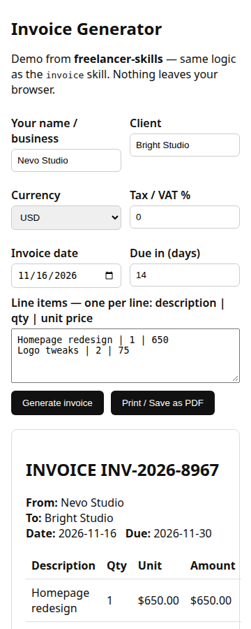
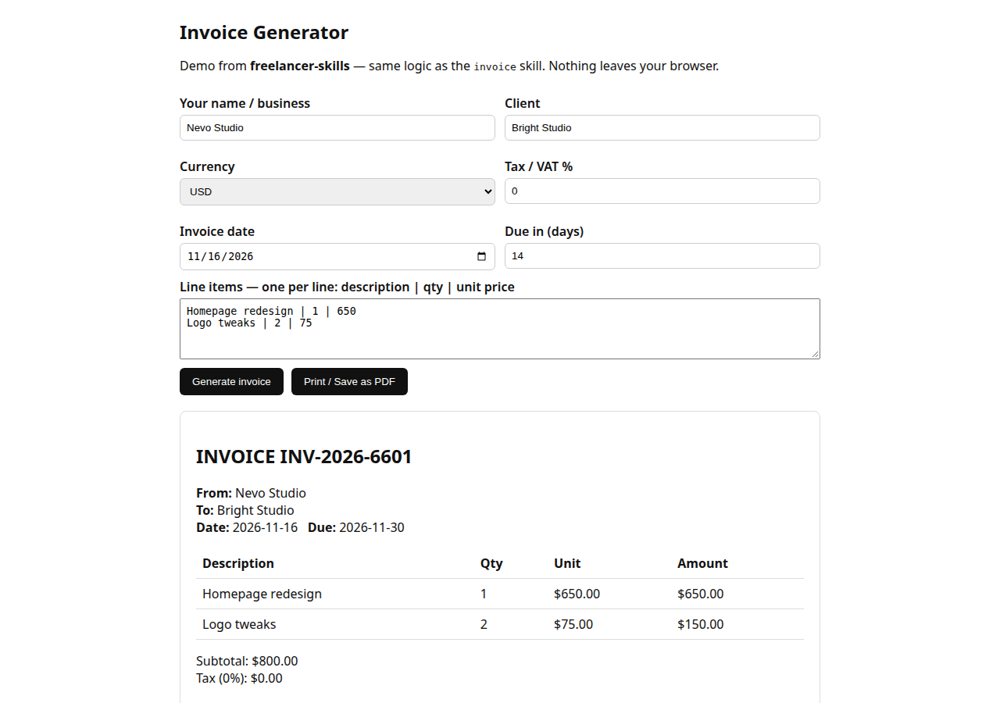

<div align="center">

# freelancer-skills

**Claude Code skills for solo freelancers — the money work, not the code work.**

Invoice, quote, track expenses, chase late payments, and close the month — from a plain-English prompt. No API key, no backend, no signup.

[](https://github.com/smabdulmueid97/freelancer-skills/blob/main/LICENSE)
[](https://github.com/smabdulmueid97/freelancer-skills/stargazers)
[](https://github.com/smabdulmueid97/freelancer-skills/commits/main)

**[▶ Try it in 10 seconds — live demo](https://smabdulmueid97.github.io/freelancer-skills/)**

No Claude needed: type a client + amount, print to PDF. Nothing leaves your browser.

</div>

---

## Screenshots

| Mobile | Desktop |
|---|---|
|  |  |

> Tested at 360 / 768 / 1280 px — no horizontal overflow, no clipped buttons.

---

## What it does

| Skill | Trigger | What it does |
|---|---|---|
| `invoice` | "invoice Acme for $800 for the website" | Professional invoice — numbered, dated, due date, tax/VAT, multi-currency — as Markdown + printable HTML/PDF |
| `quote` | "quote $1,200 for a logo + 2 revisions" | Fixed-price quote with scope, exclusions, 14-day validity, payment terms |
| `expense-tracker` | "log $45 for Figma, client Acme" | Logs an expense, categorises it, running monthly total per client / category |
| `payment-followup` | "chase the unpaid invoice #104" | Polite 1st / 2nd / final reminder — firm, not rude — with exact amount, due date, payment link |
| `monthly-summary` | "close October" | Totals invoiced, paid, outstanding, expenses and profit for the month, per client, with the top 3 overdue invoices |

Each skill is one `SKILL.md` — read it, copy the folder, done. No dependencies.

## Why this exists

Checked GitHub Trending on 2026-11-14 (daily + weekly + monthly, ~50 repos). The pattern was impossible to miss:

1. **Agent skills are the #1 trending category.** `anthropics/skills`, `addyosmani/agent-skills`, `mattpocock/skills`, `claude-trading-skills`, `cloudflare/security-audit-skill`, `taste-skill`, `claude-mem` — 12+ of the top 50 are Claude Code skills / plugins.
2. **Dev tools + security review are next.** `alibaba/open-code-review`, `openai/codex-security`, `chrome-devtools-mcp`.
3. **Money workflows trend too.** `daily_stock_analysis`, `claude-trading-skills`, `sure` (personal finance).
4. **Self-hosted, zero-setup, try-it-in-browser wins.** `uptime-kuma`, `agent-browser`, `lobehub` — people star what they can use immediately.

The gap: every trending skill pack is for developers, traders, or SEO. None covers the daily money workflow of a freelancer — invoicing, quotes, expenses, late-payment follow-ups. That's this repo.

## Install — 30 seconds

```bash
git clone https://github.com/smabdulmueid97/freelancer-skills.git
./scripts/install.sh
# copies skills/ → ~/.claude/skills/
```

Or manually: copy any `skills/<name>/` folder into `~/.claude/skills/<name>/`.

## Use it

Then in Claude Code, just talk normally:

```
invoice Bright Studio for $650 — homepage redesign, 50% upfront, due in 14 days
quote $900 for a landing page, 2 revisions, valid 14 days
log $29 for hosting, client Bright Studio
chase invoice #INV-1042, it's 12 days overdue
close October
```

## No-Claude demo

`demo/index.html` is a single-file invoice generator (the same logic as the `invoice` skill, in the browser):

- Add line items, tax / VAT, discount, multi-currency (USD, EUR, GBP, BDT, INR)
- Auto invoice number + due date, saves to localStorage — nothing leaves your browser
- Print / Save as PDF

Open the file locally, or use the [live demo](https://smabdulmueid97.github.io/freelancer-skills/).

## Rules every skill follows

- Never invent a client, amount, date or rate. Ask if it's missing.
- Money is always shown with currency + 2 decimals. Totals are recomputed, never copied from the prompt.
- Dates are ISO (`2026-11-14`), due date defaults to +14 days unless told otherwise.
- Output is Markdown first, HTML/PDF second. No external services.

## Repo layout

```
skills/
  invoice/SKILL.md
  quote/SKILL.md
  expense-tracker/SKILL.md
  payment-followup/SKILL.md
  monthly-summary/SKILL.md
demo/index.html          # single-file invoice generator, no build step
scripts/install.sh       # copies skills to ~/.claude/skills/
```

## Related repos

- [social-media-posting](https://github.com/smabdulmueid97/social-media-posting) — one idea into posts for YouTube, Instagram, Facebook, TikTok, Bilibili, LinkedIn, and X
- [long-to-short-video](https://github.com/smabdulmueid97/long-to-short-video) — turn a long video into short vertical clips, with an ffmpeg cutter
- [invoice-generator](https://github.com/smabdulmueid97/invoice-generator) — free browser invoice generator, print to PDF

## Contributing

One skill = one folder, one `SKILL.md`, one worked example. Keep it under 150 lines. PRs welcome.

## License

MIT — use it, sell with it, no attribution required.
